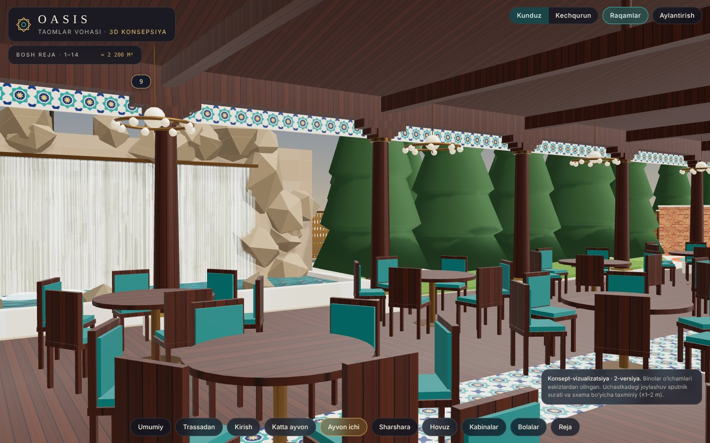
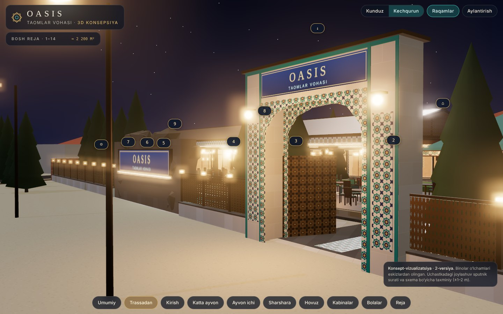

# Oasis — Taomlar Vohasi

Trassa bo‘yidagi restoranning **3D konsepsiyasi** (2-versiya): joylashuv va tashqi ko‘rinish. Smeta va material sarfi keyingi bosqichda qilinadi.

**3D modelni ochish:** `index.html` faylini brauzerda oching. Internet kerak, chunki three.js va shriftlar CDN’dan yuklanadi.
Ichida: kunduz/kechqurun rejimi, 1–14 raqamlari, tayyor ko‘rinishlar (trassadan, kirish, katta ayvon, ayvon ichi, sharshara, hovuz, kabinalar, bolalar maydonchasi, reja).

## G‘oya

**“Ipak yo‘li vohasi”**: zamonaviy toza chiziqlar bilan o‘zbek me’morchiligining uch materiali birlashtirilgan:

- **pishgan g‘isht**: to‘siq devorlar, kabinalarning orqa devori;
- **firuza majolika (girih naqsh)**: kirish peshtog‘i, frizlar, ustun yonidagi tasmalar, hovuz tubi;
- **bronza va yong‘oq**: deraza ramkalari, o‘yma ustunlar, panjaralar, yog‘och shiftlar.

Mehmon trassadan firuza peshtoq orqali kiradi. O‘ng tomonda sharshara va katta ochiq ayvon, chap tomonda hovuz atrofidagi shiyponlar turadi.
Sharshara trassa shovqinini to‘sadi. Orqa tomonidagi “OASIS” yozuvi yo‘ldan ko‘rinib turadi.

## Bosh reja

| № | Nomi | Vazifasi | O‘lcham (eskizdan) |
|---|------|----------|--------------------|
| 1 | Oshxona | oshxona | 12.10 × 7.20 m, h 3.57 m; derazalar 3.72 / 3.54 / 3.70 × 2.27 m, tokcha 0.90 m; eshik 2.00 × 2.55 m |
| 2 | Samarqand · Buxoro · Xiva · Shahrisabz | 4 ta kabina | 4.40 / 4.44 / 4.35 / 4.15 × 3.45 m, jami 17.62 m, tom 4.97 m |
| 3 | Toshkent | kabina | 4.87 × 3.45 m |
| 4 | Termiz · Qo‘qon · Marg‘ilon | 3 ta kabina | 3.98 / 3.92 / 3.64 × 3.45 m, jami 11.74 m |
| 5 · 6 · 7 | Farg‘ona · Namangan · Andijon | kabinalar | 3.48 / 3.78 / 3.52 × 3.42 m |
| — | yordamchi xonalar | 3×3 va 2.25 × 2.25 | 4-bino bilan yo‘lak orasida |
| 8 | Katta ayvon | yon tomonlari ochiq, tomi bor | 30.10 × 11.40 m, har tomonda 9 ta ustun (8 oraliq), qatorlar orasi 9 m |
| 9 | Sharshara | suv devori | 10 × 4 m, ayvondan 2 m oldinda |
| 10–13 | Anor · Behi · Uzum · Anjir | shiyponlar | 4.60 × 4.60 m, h 2.66 m |
| 14 | Katta shiypon | olti burchakli | 7.90 × 4.60 m |
| ◆ | Hovuz | favvora | Ø 4.48 m |
| ☺ | Bolalar maydonchasi | o‘yin zonasi | Ø ≈ 6.5 m |

Taxminiy sig‘im: ayvonda ~126, kabinalarda ~90, shiyponlarda ~45, jami **~260 o‘rin**.

## Qabul qilingan farazlar (tekshirib berish kerak)

1. Uchastka o‘lchami sputnik surati bo‘yicha olindi, masshtab 8-ayvonning uzunligidan (30.10 m): uy tomoni ≈ 60 m, g‘arbiy devor ≈ 55 m, maydoni ≈ 2 200 m². Joylashuv xatosi ±1–2 m.
2. Kirish trassadan, 9 bilan 11 orasidan, 4.60 m yo‘lak orqali (9–8-varaqdagi 4.60 o‘lchami).
3. Hovuz majmuasi sputnikdagi kabi ayvonning g‘arbida. O‘qi trassaga parallel, 14-shiypon g‘arb tomonda.
4. 2, 3, 4-binolar janubda, uy devori bo‘ylab joylashgan, 1-oshxona ularning g‘arbiy uchida. 5–7 sharqiy ko‘cha bo‘ylab turadi, oldida uyga olib boruvchi 2.10 m yo‘lak (oxirida 0.68 m eshik).
5. Kabinalarda havo tortgich va qo‘l yuvgich bor deb olindi (8-varaqdagi belgilar).
6. Ayvon tomi tunuka (bronza rang) deb olindi. Ustunlar yong‘oq qoplamali, fermalar ochiq.

## Fayllar

- `index.html`: interaktiv 3D model (three.js 0.160, hamma geometriya va teksturalar kodda yaratilgan).
- `docs/eskizlar/`: buyurtmachining asl eskizlari va sputnik surati.
- `docs/renderlar/`: modeldan olingan kadrlar.
