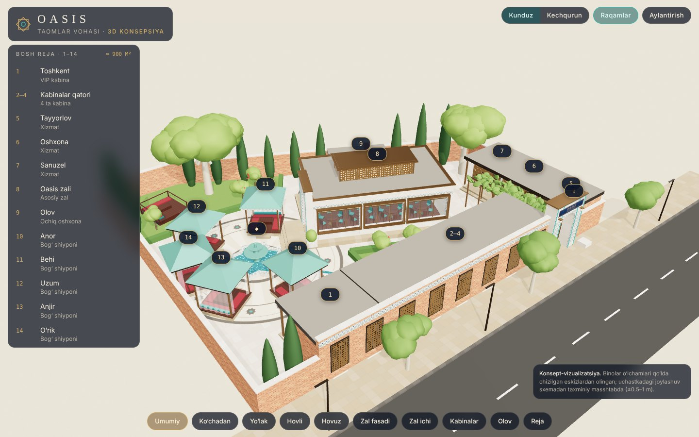
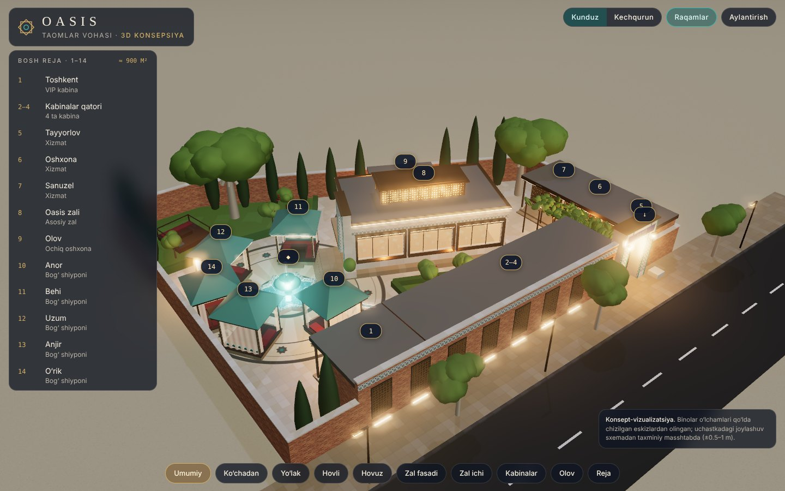

# Oasis — Taomlar Vohasi

Restoran loyihasining **3D konsepsiyasi**. Joylashuv va tashqi ko‘rinish. Smeta va material sarfi keyingi bosqichda qilinadi.

**3D modelni ochish:** `index.html` faylini brauzerda oching. Internet kerak, chunki three.js va shriftlar CDN’dan yuklanadi.
Ichida: kunduz/kechqurun rejimi, 1–14 raqamlari, tayyor ko‘rinishlar (ko‘chadan, yo‘lak, hovli, hovuz, zal fasadi, zal ichi, kabinalar, olov, reja).

## G‘oya

**“Ipak yo‘li vohasi”**: zamonaviy toza chiziqlar bilan o‘zbek me’morchiligining uch materiali birlashtirilgan:

- **pishgan g‘isht**: ko‘cha fasadi, to‘siq devorlar, kabinalarning orqa devori;
- **firuza majolika (girih naqsh)**: peshtoq, derazalar ustidagi friz, ustun yonidagi tasmalar, hovuz tubi;
- **bronza va yong‘oq**: deraza ramkalari, 125 mm ustunlar, yashirin LED chiziqli yog‘och shiftlar.

Uchastkaning markaziy o‘qi suv: darvozadan **ariq** boshlanadi, tok so‘ri ostidan o‘tadi va sakkiz qirrali **hovuz**ga quyiladi.
Hovuz atrofida beshta shiypon joylashgan.

## Bosh reja (eskiz raqamlari bo‘yicha)

| № | Nomi | Vazifasi (taklif) | O‘lcham (eskizdan) |
|---|------|-------------------|--------------------|
| 1 | Toshkent | VIP kabina, 10–12 o‘rin | 4.87 × 3.45 m, tom chuqurligi 4.97 m |
| 2–4 | Samarqand · Buxoro · Xiva · Shahrisabz | 4 ta kabina, 8–10 o‘rindan | 4.40 / 4.44 / 4.35 / 4.15 × 3.45 m, jami 17.62 m |
| 5 | Tayyorlov | sovuq sex | 3.98 × 3.45 m |
| 6 | Oshxona | issiq sex | 3.92 × 3.45 m |
| 7 | Sanuzel | E / A | 3.64 × 3.45 m (5–7 jami 11.74 m) |
| 8 | Oasis zali | asosiy zal, ~48 o‘rin | 12.10 × 7.20 m, h 3.57 m; derazalar 3.72 / 3.54 / 3.70 × 2.27 m, tokcha 0.90 m; eshik 2.00 × 2.55 m |
| 9 | Olov | mangal + tandir, ochiq oshxona | ≈ 5.6 × 2.1 m |
| 10–14 | Anor · Behi · Uzum · Anjir · O‘rik | bog‘ shiyponlari, 6–8 o‘rindan | 3.0 × 3.0 m (taklif) |
| ◆ | Hovuz | sakkiz qirrali yulduz | Ø 4.8 m, maydon Ø 14.8 m |

Taxminiy sig‘im: **~140 o‘rin**.

## Qabul qilingan farazlar (tekshirib berish kerak)

1. Uchastka o‘lchami bosh reja sxemasidan zal (12.10 m) bo‘yicha masshtablab olindi: taxminan **36 × 31 m, ≈ 900 m²**. Joylashuvdagi xato ±0.5–1 m.
2. 2, 3, 4-varaqlardagi 3.45 / 3.57 m: xona chuqurligi (devor 0.12 m). 4.97 m: old ayvon bilan birga tom chuqurligi. 0.125 m: ayvon ustunlari.
3. Zal derazalari janubiy (hovuz va ariq tomondagi) uzun devorga, 2 m eshik g‘arbiy kalta devorga, janub burchagiga yaqin qo‘yilgan.
4. 5–7-bloklar oshxona va sanuzel deb taklif qilindi: darvoza yonida turgani uchun mahsulot kiritish qulay. Agar oshxona boshqa joyda bo‘lsa, bular ham kabina qilinadi.
5. Kirish darvozasi eskizdagi kichik belgiga ko‘ra 4-blok bilan 5-blok orasida, ko‘cha tomonda.
6. Shimol yo‘nalishi va qo‘shni binolar noma’lum. Quyosh shartli ravishda janubi-g‘arbdan tushadi.

## Fayllar

- `index.html`: interaktiv 3D model (three.js 0.160, hamma geometriya va teksturalar kodda yaratilgan).
- `docs/eskizlar/`: buyurtmachining asl eskizlari.
- `docs/renderlar/`: modeldan olingan kadrlar.
